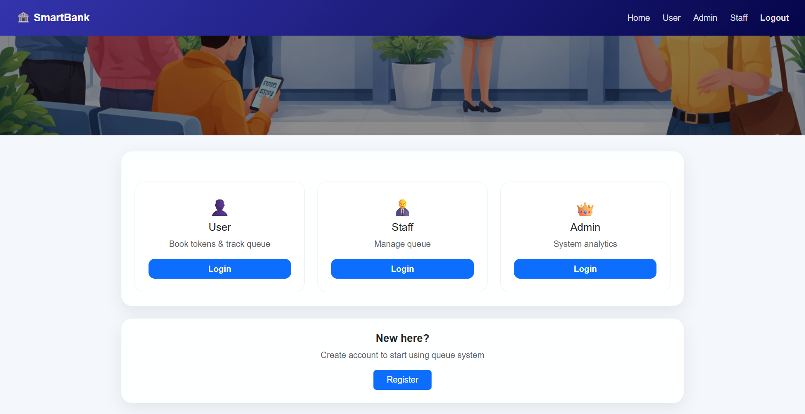

# Smart Bank Queue Optimization System

A smart, responsive web-based queue management system designed to optimize customer flow in banking environments, reduce waiting time, and improve overall service efficiency.

---

## 🚀 Project Overview

The **Smart Bank Queue Optimization System** helps banks manage customer queues intelligently by estimating wait times and improving service allocation between staff and users. It provides separate dashboards for **Admin, Staff, and Users**, ensuring smooth coordination and transparency.

---

## 🖥️ Tech Stack

### Frontend

* HTML
* CSS
* Bootstrap
* JavaScript
* React.js

### Backend

* Flask (Python Web Framework)

### Database

* Flask SQLAlchemy

---

## 📸 Screenshots

All screenshots are stored in: `static/screenshots/`

### Home Pages

  

---

### Registration

---

### Admin Panel

---

### Staff Dashboard

  
  

---

### User Interface

  

---

## ⏱️ Wait Time Formula

The system estimates waiting time using:

Wait Time = Queue Length × Average Service Time

This simple model helps predict how long a customer might need to wait based on current queue conditions.

---

## 🎯 Key Features & Impact

* ⏳ Reduces customer waiting time through optimized queue handling
* 😊 Improves overall customer experience
* ⚙️ Enhances service efficiency for bank staff
* 📊 Provides real-time queue visibility for better decision-making

---

## 👥 User Roles

### Admin

* Manage system users
* Monitor overall queue status
* Control system settings

### Staff

* Handle customer service tokens
* Update queue progress
* Manage service status

### User

* Register and login
* Take queue token
* View estimated waiting time

---

## 🧠 System Logic

The system dynamically calculates wait time using current queue length and average service time, helping users make informed decisions before joining or waiting in the queue.

---

## 📌 Future Improvements

* SMS/Email notifications for token updates
* AI-based dynamic service time prediction
* Real-time dashboard using WebSockets
* Mobile app integration

---

## 📎 Note

This project demonstrates a full-stack queue optimization system using Flask and modern frontend tools, focused on improving real-world banking service efficiency.
